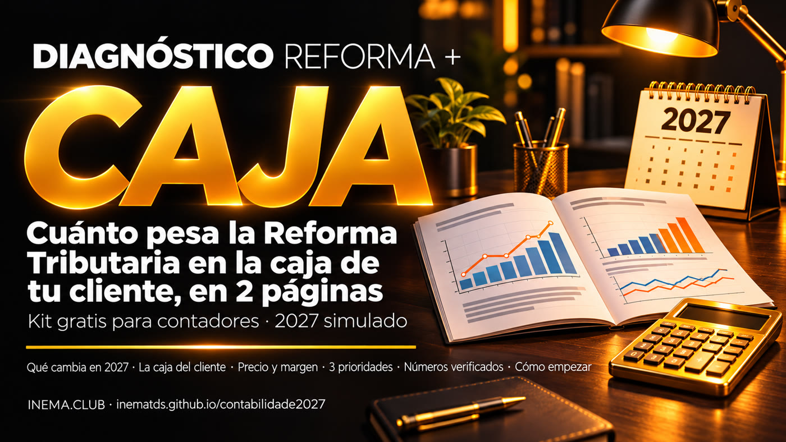

# Diagnóstico Reforma + Caixa

**🇧🇷 [Português](README.md) · 🇺🇸 [English](README.en.md) · 🇪🇸 [Español](README.es.md)**

[](https://inematds.github.io/contabilidade2027/guia/es/)

## Qué es

Tu cliente va a preguntar cuánto impacta la Reforma Tributaria en su flujo de caja en 2027. Este kit gratuito ayuda al contador a responder con los números del propio cliente. Colocas en una carpeta lo que ya tienes (el resumen mensual de ingresos, costos, impuestos y saldo y, si quieres, gastos y precios) y tu IA prepara un informe de 2 páginas para el dueño de la empresa: cuánto queda, cómo está el flujo de caja, cuánto pagaría de CBS/IBS en 2027 en dos escenarios de tasa, el efecto del split payment, qué llamó la atención y 3 prioridades. Un verificador garantiza que todos los números del informe provengan de los datos. Es un kit de INEMA, no oficial, y no sustituye el análisis técnico del contador.

## 📖 Guía de uso

Guía completa: **https://inematds.github.io/contabilidade2027/guia/es/**

<!-- VIDEO: entra o explicavideo do projeto quando publicado -->

## Pídele ayuda a tu IA

Abre Claude Code o Codex en una carpeta de tu computadora y pega la solicitud de [`kit/PEDIDO.md`](kit/PEDIDO.md). La IA ejecutará el ejemplo, preparará la carpeta de tu cliente, generará el informe, lo reescribirá en lenguaje sencillo sin modificar los números y lo verificará. No se envía nada a nadie: tú revisas el informe y hablas con el cliente.

## Qué incluye el informe

1. **Cuánto queda:** ingresos, ganancias y margen del período, y el margen de los últimos 3 meses comparado con el de los meses anteriores.
2. **Tu flujo de caja:** saldo, salidas promedio, cuántos meses de salidas cubre el saldo y los meses de mayor presión.
3. **Reforma en 2027 (SIMULADO):** PIS/Cofins actual × CBS/IBS en dos escenarios (8,8% del ejemplo oficial de Receita y 11,3% de la recomendación del TCU), una nota para quienes venden a empresas y cuánto impuesto deja de pasar por el flujo de caja con el split payment. En el Simples, el aviso sobre créditos para clientes empresariales.
4. **Qué llamó la atención:** gastos por encima del promedio y artículos con margen por debajo de la meta, con el precio mínimo.
5. **3 prioridades**, ordenadas por valor en R$, cada una vinculada a un servicio que el contador puede ofrecer, más una agenda para una reunión de 30 minutos.

Ejemplos listos: [`kit/exemplos/agencia/saida-exemplo/relatorio-base.md`](kit/exemplos/agencia/saida-exemplo/relatorio-base.md) (Lucro Presumido) y [`kit/exemplos/loja-simples/saida-exemplo/relatorio-base.md`](kit/exemplos/loja-simples/saida-exemplo/relatorio-base.md) (Simples). Todos los datos son ficticios.

---

## Instalación técnica

Solo necesitas **Python 3.9+**, sin bibliotecas adicionales. No usa internet ni modelos de IA: el script solo lee y calcula.

```bash
git clone https://github.com/inematds/contabilidade2027 && cd contabilidade2027
# ou baixe o ZIP: https://github.com/inematds/contabilidade2027/archive/refs/heads/main.zip

python3 kit/diagnostico.py kit/exemplos/agencia            # gera kit/exemplos/agencia/saida/
python3 kit/conferir.py kit/exemplos/agencia/saida/relatorio-base.md kit/exemplos/agencia/saida/dados.json
python3 -m unittest discover -s tests                        # 15 testes
```

### La carpeta del cliente

Copia `kit/modelo/` y complétala. CSV con separador `;` y coma decimal, como los guarda Excel en portugués.

| Archivo | Obligatorio | Columnas |
|---|---|---|
| `empresa.json` | sí | `nome`, `regime` (`simples`, `presumido` ou `real`), `atividade`, `reducao_aliquota_pct` (0, 30 ou 60), `cenarios_cbs_pct`, `ibs_2027_pct`, `prazo_medio_recebimento_dias`, `dia_vencimento_impostos`, `vendas_para_empresas_pct`, `margem_alvo_pct` |
| `mensal.csv` | sí (3+ meses) | `mes;receita;compras_com_credito;custo_direto;despesas_operacionais;pis_cofins_pago;outros_impostos;saldo_caixa_fim` |
| `despesas.csv` | no | `mes;categoria;valor` (el último mes se compara con el promedio de los anteriores) |
| `produtos.csv` | no | `item;preco;custo_direto;qtd_mes` |

`compras_com_credito` es la parte de las compras que generará crédito de CBS/IBS (insumos y servicios de proveedores del régimen regular). La nómina no se incluye.

### Cómo se hace el cálculo (premisas)

- **CBS/IBS de 2027 (régimen regular):** `(receita − compras_com_credito) × alíquota de referência × (1 − redução)`, anualizado, comparado con el PIS/Cofins pagado. En 2027, la CBS es la referencia menos 0,1 punto (LC 214, art. 347) y el IBS es 0,05% estatal + 0,05% municipal (art. 344), por lo que ambos suman la propia referencia. Es una simplificación: la base es el ingreso informado, sin ajustes por otros impuestos (la LC 214, art. 12, excluye de la base la propia CBS/IBS y el IPI).
- **Crédito:** solo sobre lo que informes en `compras_com_credito`. Las compras a proveedores del Simples generan un crédito limitado a lo que pagan en el Simples. Ajusta la columna.
- **Producto:** usa la misma regla de crédito que la empresa. La parte del costo que genera crédito es `compras_com_credito ÷ custo_direto` del período. El precio mínimo devuelve la `margem_alvo_pct` en el peor escenario.
- **Split payment:** `receita média × alíquota do pior cenário × dias ÷ 30`, con ventas a mitad de mes, cobro en `prazo_medio_recebimento_dias` y vencimiento el día `dia_vencimento_impostos` del mes siguiente. Es una estimación máxima, sin descontar créditos. La implementación es gradual y depende de un acto conjunto del Comité Gestor y de Receita (LC 214, art. 35).
- **Simples:** no simula cambios en el DAS. Avisa cuando la mayor parte de las ventas es a empresas. La opción de pagar la CBS/IBS fuera del DAS es semestral, se elige en septiembre y marzo (LC 123, art. 13, §§ 9–10, con la redacción de la LC 227/2026).
- **Todo lo de 2027 aparece marcado como SIMULADO.** La tasa de referencia de la CBS la fija el Senado (plazo: 15/12/2026). Vuelve a hacer el cálculo cuando se publique.

### El verificador

`kit/conferir.py relatorio.md dados.json` devuelve el código 1 si el texto contiene:
- un valor en R$, % o un número con coma que no esté en `dados.json`;
- un redondeo expresado con palabras («62 mil»);
- una cantidad de días o meses inventada.

Sirve para la etapa en que la IA reescribe el informe en lenguaje sencillo.

### Las pruebas

`tests/test_kit.py` (15) cubre:
- el cálculo verificado manualmente en el ejemplo de la agencia (CBS, PIS/Cofins, split, gastos, precio mínimo);
- el Simples;
- el Lucro Real con crédito;
- la reducción del 60%;
- el verificador detectando números inventados, redondeados y premisas usadas como números;
- errores de entrada y la línea de comandos.

## El proceso, de principio a fin

1. 🧠 El contador abre Claude Code o Codex y pega la solicitud de `kit/PEDIDO.md`.
2. ⚙️ `python3 kit/diagnostico.py kit/exemplos/agencia`: ejecuta el ejemplo para ver el formato.
3. 🧠 Prepara la carpeta del cliente a partir de `kit/modelo/`, con los datos que ya tiene.
4. ⚙️ `python3 kit/diagnostico.py <pasta-do-cliente>` → `saida/relatorio-base.md` + `saida/dados.json`.
5. 🧠 La IA reescribe el informe en `relatorio.md`, en lenguaje sencillo y sin modificar los números.
6. ⚙️ `python3 kit/conferir.py relatorio.md saida/dados.json`: debe devolver `ok`.
7. 🧠 El contador revisa las premisas y lleva el informe a la reunión con el cliente.
8. ⚙️ `python3 -m unittest discover -s tests`: antes de modificar el código.

## Fuentes

- Tasas de los escenarios: [kit calculadora-da-reforma](https://github.com/inematds/calculadora-da-reforma) (ejemplo oficial de Receita con CBS de 8,8%) y [TCU, 28/10/2026](https://portal.tcu.gov.br/imprensa/noticias/tcu-calcula-aliquota-de-referencia-de-113-para-novo-tributo-sobre-consumo) (tasa de referencia de 11,3%; el Senado la fija hasta el 15/12).
- Reglas de 2027: [LC 214/2025, texto no Senado](https://legis.senado.leg.br/norma/40180341/publicacao/40181429) (arts. 12, 35, 47, 344 e 347) y [LC 227/2026, texto atualizado na Câmara](https://www2.camara.leg.br/legin/fed/leicom/2026/leicomplementar-227-13-janeiro-2026-798657-normaatualizada-pl.html) (opção do Simples). Verificado el 24/11/2026.
- Para verificar el cálculo ítem por ítem en el motor oficial de Receita, usa la prueba del motor de calculadora-da-reforma.

Licencia MIT. Kit de INEMA, no oficial. No sustituye el análisis técnico del contador. Gratis en inema.club, directamente en internet.
